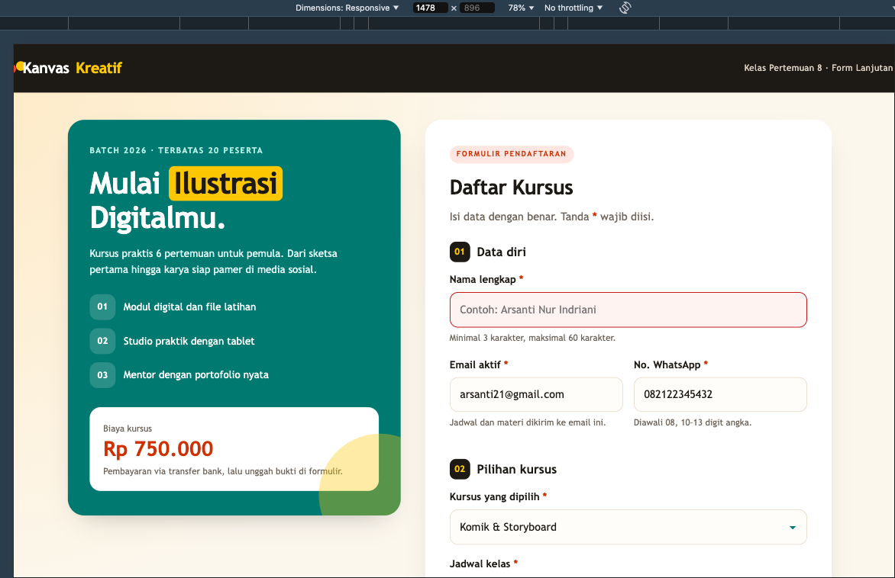
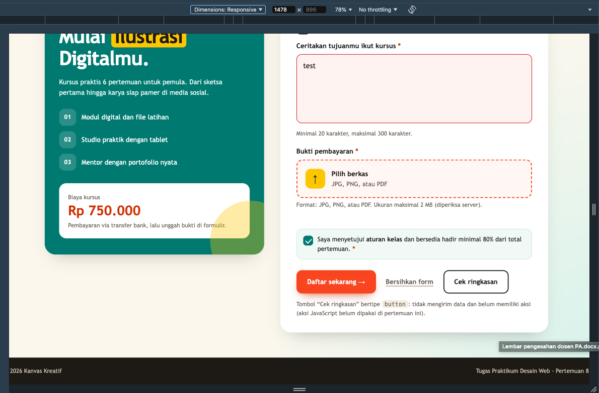
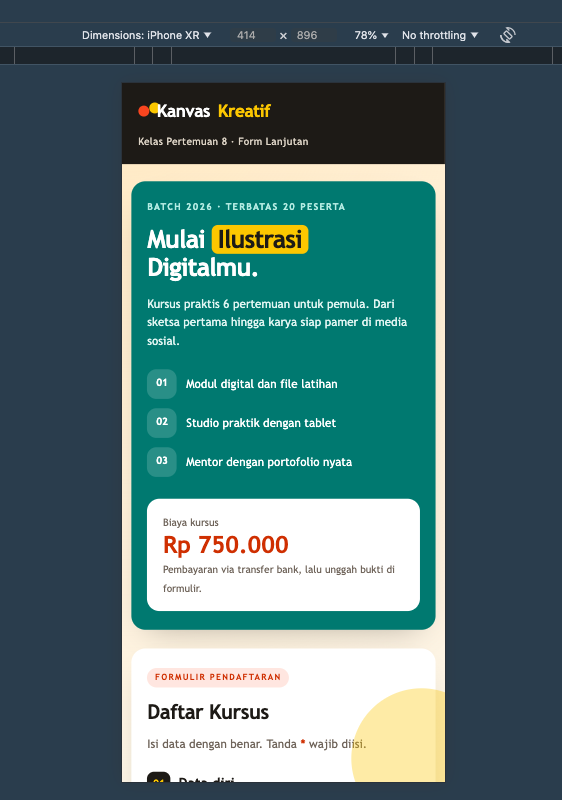
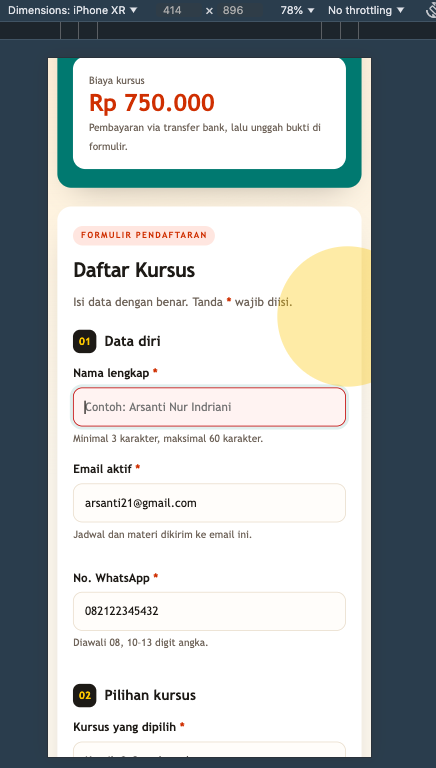
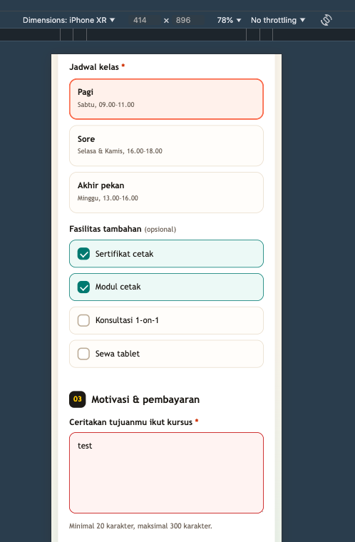
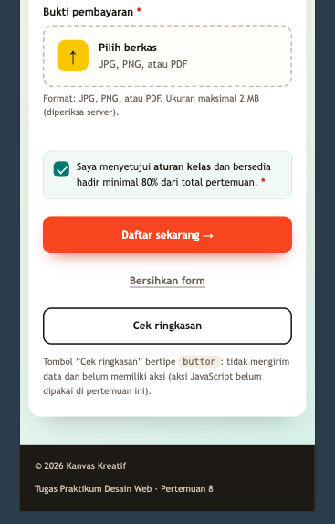

# Form Pendaftaran Kursus — Pertemuan 8

## Biodata Mahasiswa

|               |                                  |
| ------------- | -------------------------------- |
| Nama          | Arsanti Nur Indriani             |
| NIM           | 4525210128                       |
| Program Studi | Teknik Informatika               |
| Mata Kuliah   | Praktikum Desain Web             |
| Kelas         | A                                |
| Pertemuan     | 8 - HTML Form Lanjutan           |

## Deskripsi
Halaman pendaftaran kursus **Ilustrasi & Desain Digital** dengan tema "Kanvas Kreatif". Dibuat dengan HTML5 dan CSS3 murni, tanpa Bootstrap, tanpa JavaScript, dan tanpa framework, sesuai materi Pertemuan 7–8.

## Struktur Folder
```text
tugas-praktikum-4525210128/
├── css/
│   └── style.css
├── images/          (screenshot desktop & mobile)
├── index.html
└── README.md
```

## Elemen Form yang Digunakan
| Kebutuhan tugas | Elemen | Keterangan |
|---|---|---|
| Radio button | `input type="radio"` | Jadwal kelas (Pagi / Sore / Akhir pekan), satu `name="jadwal"` |
| Checkbox | `input type="checkbox"` | Fasilitas tambahan (opsional) dan persetujuan aturan kelas (wajib) |
| Select box | `select` | Pilihan kursus |
| Textarea | `textarea` | Motivasi, minimal 20 karakter |
| Upload pembayaran | `input type="file"` | `accept` JPG/PNG/PDF, `enctype="multipart/form-data"` pada form |
| Tombol 1 | `type="submit"` | Daftar sekarang |
| Tombol 2 | `type="reset"` | Bersihkan form |
| Tombol 3 | `type="button"` | Cek ringkasan (belum memiliki aksi, karena JavaScript belum dipakai) |

## Aturan Validasi HTML5 (9 aturan, minimal 4 terpenuhi)
1. **Nama lengkap**: `required`, `minlength="3"`, `maxlength="60"`.
2. **Email**: `type="email"` dan `required`. Browser memeriksa format `nama@domain`.
3. **No. WhatsApp**: `required`, `pattern="08[0-9]{8,11}"`, `minlength="10"`, `maxlength="13"`.
4. **Kursus**: `required` pada `select`, opsi placeholder `disabled`.
5. **Jadwal**: `required` pada grup radio. Cukup satu radio di grup yang wajib.
6. **Motivasi**: `required`, `minlength="20"`, `maxlength="300"`.
7. **Bukti pembayaran**: `required` dan `accept` membatasi jenis berkas.
8. **Persetujuan aturan kelas**: checkbox `required`.

Checkbox fasilitas tidak diberi `required` karena bersifat opsional.

## Catatan Desain Responsif
- Layout dua kolom di desktop (lebar ≥ 900px) berubah menjadi satu kolom di mobile.
- Tombol dan input memiliki tinggi minimal 48px agar nyaman disentuh.
- Status invalid (`:user-invalid`) hanya muncul setelah pengguna mengisi lalu meninggalkan field, sehingga form tidak tampil merah sejak awal.

## Skenario Uji Input Salah (5 skenario, minimal 5 terpenuhi)

| No. | Field | Input uji | Hasil yang diharapkan |
|---|---|---|---|
| 1 | Nama lengkap | Dibiarkan kosong, lalu klik "Daftar sekarang" | Form tidak terkirim. Browser menampilkan pesan wajib diisi pada field Nama. |
| 2 | Nama lengkap | `Al` (2 karakter) | Form tidak terkirim. Browser meminta minimal 3 karakter. |
| 3 | No. WhatsApp | `0812abc` | Form tidak terkirim. Pesan dari atribut `title` muncul: nomor harus diawali 08 dan berisi 10–13 digit angka. |
| 4 | Email | `budi@` | Form tidak terkirim. Browser meminta format email yang valid. |
| 5 | Motivasi | `Saya ingin ikut` (15 karakter) | Form tidak terkirim. Browser meminta minimal 20 karakter. |
| 6 | Persetujuan | Checkbox aturan kelas tidak dicentang | Form tidak terkirim. Browser meminta persetujuan. |
| 7 | Bukti pembayaran | Berkas `.docx` atau `.txt` | Dialog pilih berkas menyaring jenis yang diizinkan. Namun jika pengguna tetap memilih "All files" dan berkas `.txt` dikirim, browser tetap mengirim form. Atribut `accept` hanya membantu, bukan pengaman. |

## Test Case Validasi

Kolom **Hasil aktual** wajib diisi sendiri setelah menguji di browser. Catatan: pesan bawaan browser berbeda tergantung bahasa dan browser (misalnya "Please fill out this field" atau "Harap isi bidang ini").

| No. | Field | Input uji | Hasil yang diharapkan | Hasil aktual |
|---|---|---|---|---|
| TC-01 | Nama lengkap | (kosong) | Submit ditolak, pesan wajib diisi | *isi setelah uji* |
| TC-02 | Nama lengkap | `Al` | Submit ditolak, minimal 3 karakter | *isi setelah uji* |
| TC-03 | No. WhatsApp | `0812abc` | Submit ditolak, sesuai pattern | *isi setelah uji* |
| TC-04 | No. WhatsApp | `0812345678901234` (16 digit) | Browser tidak mengizinkan mengetik lebih dari 13 karakter (`maxlength`). Isi berhenti di 13 digit. | *isi setelah uji* |
| TC-05 | Email | `budi@` | Submit ditolak, format email tidak valid | *isi setelah uji* |
| TC-06 | Kursus | Tidak memilih (placeholder) | Submit ditolak | *isi setelah uji* |
| TC-07 | Jadwal | Tidak memilih radio | Submit ditolak | *isi setelah uji* |
| TC-08 | Motivasi | `Saya ingin ikut` | Submit ditolak, minimal 20 karakter | *isi setelah uji* |
| TC-09 | Bukti | Tidak ada berkas | Submit ditolak | *isi setelah uji* |
| TC-09b | Bukti | Berkas `.txt` (dipilih lewat "All files") | Browser tetap mengirim form. Penolakan jenis berkas harus dilakukan server. | *isi setelah uji* |
| TC-10 | Persetujuan | Tidak dicentang | Submit ditolak | *isi setelah uji* |
| TC-11 | Seluruh form | Semua valid, berkas PDF ≤ 2 MB | Submit diterima browser (dikirim ke `action`) | *isi setelah uji* |
| TC-12 | Tombol reset | Mengisi lalu klik "Bersihkan form" | Semua field kembali kosong | *isi setelah uji* |

## Validasi yang Tetap Wajib di Server
Validasi HTML5 membantu pengalaman pengguna, tetapi mudah dilewati lewat Developer Tools atau dengan mengirim request langsung. Server tetap wajib memeriksa ulang:

- **Field wajib dan panjang teks**: nama, email, nomor WhatsApp, dan motivasi harus dicek ulang, karena `minlength` dan `required` bisa dihapus dari HTML.
- **Format nomor WhatsApp dan email** dengan aturan yang sama seperti browser.
- **Nilai select dan radio**: `kursus` dan `jadwal` hanya boleh berisi nilai yang ada di daftar. Nilai seperti `kursus=xyz` harus ditolak.
- **Checkbox fasilitas**: setiap nilai dicek terhadap daftar yang diizinkan.
- **Persetujuan**: `setuju` harus bernilai `ya` di server, bukan hanya di HTML.
- **Upload berkas**: atribut `accept` tidak mencegah submit. Jenis berkas harus diperiksa server dari isinya (magic number), bukan hanya dari ekstensi. Ukuran maksimal 2 MB juga harus dicek di server (atribut HTML tidak membatasi ukuran).
- **Pembersihan data**: nama, motivasi, dan input lain harus di-escape sebelum ditampilkan atau disimpan, untuk mencegah injeksi HTML atau skrip.
- **Pembatasan spam**: pembatasan jumlah pengiriman per IP atau token CSRF sesuai kebutuhan aplikasi.

## Perubahan, Masalah, dan Solusi

| Masalah | Penyebab | Solusi |
|---|---|---|
| Form langsung tampil merah sebelum diisi | Aturan `:invalid` aktif sejak awal | Memakai `:user-invalid` sehingga warna hanya muncul setelah interaksi |
| Input radio dan checkbox tidak terlihat jika dibuat kartu | `input` standar tampil di luar kartu | Menyembunyikan input dengan `opacity: 0` dan menata label sebagai kartu, dengan `:focus-visible` agar keyboard tetap bisa dipakai |
| Pesan `pattern` tidak jelas | Browser menampilkan pesan umum | Menambahkan atribut `title` berisi penjelasan format nomor |
| Tombol "Cek ringkasan" tidak melakukan apa-apa | Tipe `button` tidak punya aksi bawaan | Diberi catatan di halaman. Aksinya akan ditambahkan dengan JavaScript pada pertemuan berikutnya |

## Hasil Screenshot

### Desktop



### Mobile






---

© Dokumen ini dibuat untuk memenuhi tugas praktikum Desain Web, Pertemuan 8, Mata Kuliah Praktikum Desain Web, Kelas A.
